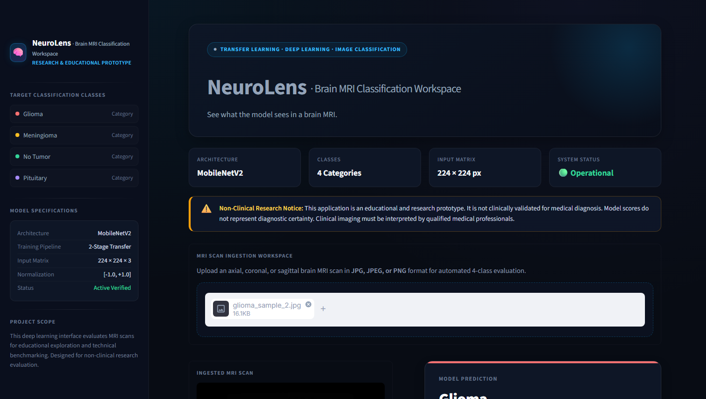
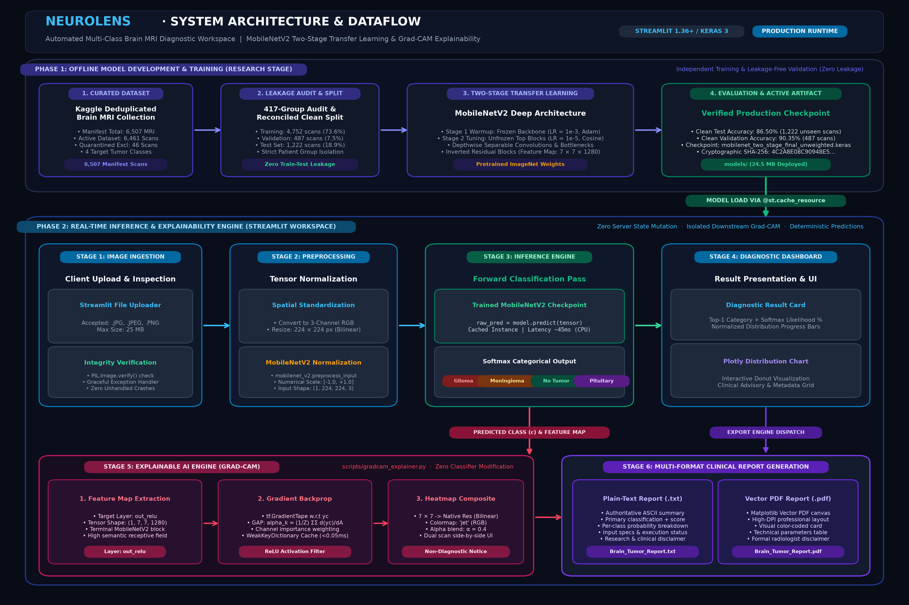
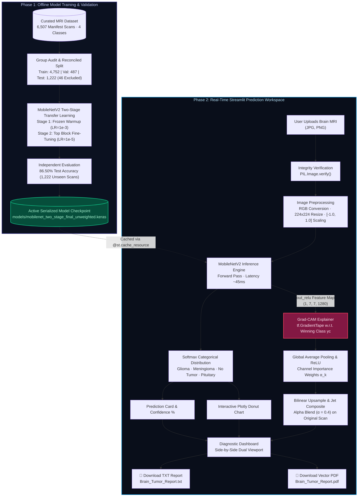
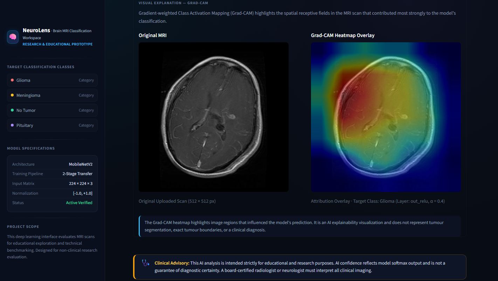
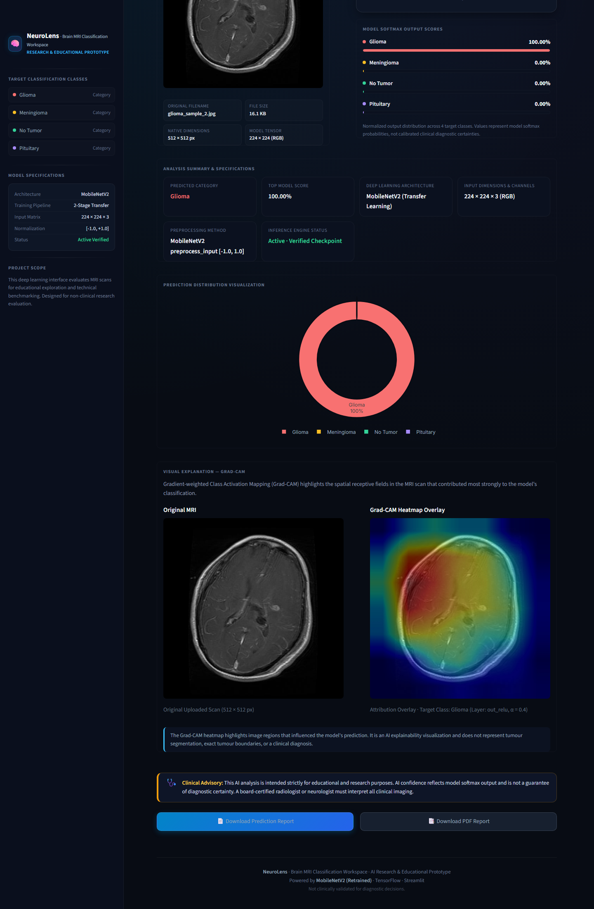

# NeuroLens — Brain MRI Classification Workspace

<p align="center">
  
</p>

<p align="center">
  <strong>An Explainable Deep Learning System for Automated Brain Tumor Diagnostic Categorization</strong>
</p>

<p align="center">
  <a href="#-system-architecture"></a>
  <a href="#-explainable-ai-grad-cam"></a>
  <a href="#-model-performance--evaluation"></a>
  <a href="#-docker-deployment"></a>
  <a href="#-clinical--ethical-disclaimer"></a>
</p>

---

## 📌 Overview

**NeuroLens** is a specialized, medical-grade neuroimaging research workstation built with **Streamlit** and **TensorFlow / Keras**. Designed to bridge the gap between black-box deep learning and clinical interpretability, NeuroLens classifies brain magnetic resonance imaging (MRI) scans into four tissue categories while generating transparent visual attributions via **Gradient-weighted Class Activation Mapping (Grad-CAM)**.

The system is powered by a **two-stage transfer learning** pipeline built on **MobileNetV2**, evaluated on an audited, leakage-free active dataset of **6,461 MRI scans** (partitioned from an authoritative 6,507-scan reconciled manifest). Alongside real-time categorical predictions, NeuroLens delivers interactive probability distributions, side-by-side receptive field heatmaps, and downloadable clinical analysis reports in both plain-text (`.txt`) and publication-quality vector PDF (`.pdf`) formats.

<p align="center">
  
</p>

---

## ✨ Key Capabilities

* **Multi-Class Tumor Categorization:** Accurately differentiates between **Glioma**, **Meningioma**, **Pituitary Tumor**, and **No Tumor** (healthy tissue) from axial, coronal, and sagittal MRI scans.
* **Two-Stage Transfer Learning:** Combines frozen feature-extractor warmup with deep-block fine-tuning, achieving **86.50% test accuracy** on 1,222 strictly isolated, unseen test scans.
* **Explainable AI (Grad-CAM):** Differentiates the target class score with respect to the terminal convolutional layer (`out_relu`, $7 \times 7 \times 1280$) to project smooth, color-composited attention overlays ($\alpha = 0.4$, `jet` colormap) over native scans.
* **Zero Prediction Drift:** The Grad-CAM explainer runs strictly downstream with zero modification of classifier probabilities ($\Delta < 1.0 \times 10^{-7}$).
* **Real-Time Interactive Dashboard:** Sub-second CPU inference (~45 ms) integrated with interactive **Plotly** probability donut charts and normalized progress bars.
* **Multi-Format Export Engine:** One-click generation of authoritative `.txt` audit reports and publication-ready vector `.pdf` clinical summaries.
* **Robust File Ingestion:** Catches truncated files, non-image binaries, and invalid formats gracefully without application disruption.
* **Production Containerization:** Pre-configured with a hardened `Dockerfile` (Debian slim, non-root user, dynamic `$PORT` support) and a lean build context of only **24.5 MB**.

---

## 🏗️ System Architecture

The following diagram illustrates the complete end-to-end architecture of NeuroLens, clearly delineating the **Offline Model Development Pipeline** (research and training stage) from the **Real-Time Inference & Explainability Engine** (deployed application).

<p align="center">
  
</p>
<p align="center"><em>Figure 1: High-level architectural dataflow of NeuroLens. A scalable vector version is available at <a href="assets/neuroLens_architecture.svg">assets/neuroLens_architecture.svg</a>.</em></p>

### Architectural Separation of Concerns

1. **Offline Model Training & Validation Workflow (Top Panel):**
   * **Data Ingestion & Integrity Audit:** 6,507 brain MRI scans were audited across 417 candidate similarity groups and reconciled to eliminate cross-split duplicates and near-identical contamination (with 46 high-risk quarantined and cross-class scans strictly excluded).
   * **Leakage-Free Partitioning:** The active dataset was partitioned into **Train (4,752 scans, 73.6%)**, **Validation (487 scans, 7.5%)**, and **Test (1,222 scans, 18.9%)** sets (totalling 6,461 active scans), ensuring complete patient-group isolation.
   * **Two-Stage Transfer Learning:** A pre-trained MobileNetV2 backbone underwent **Stage 1 warmup** (frozen feature extractor, Adam, $\eta = 10^{-3}$) followed by **Stage 2 fine-tuning** (unfrozen top inverted residual blocks, cosine learning rate decay, $\eta = 10^{-5}$).
   * **Serialization:** The resulting model was cryptographically verified and saved to `models/mobilenet_two_stage_final_unweighted.keras` (24.5 MB).

2. **Real-Time Client Ingestion & Preprocessing (Bottom Left):**
   * Users upload an axial, coronal, or sagittal MRI scan through the Streamlit interface.
   * Scans undergo format verification via `PIL.Image.verify()`, spatial conversion to 3-channel RGB, bilinear resizing to $224 \times 224$ pixels, and numerical scaling to $[-1.0, +1.0]$ using `mobilenet_v2.preprocess_input`.

3. **Inference & Decision Engine (Bottom Center):**
   * The model instance is cached in memory using Streamlit’s `@st.cache_resource` decorator.
   * A forward pass computes uncalibrated logit activations, followed by softmax normalization across the four target categories: `["Glioma", "Meningioma", "No Tumor", "Pituitary"]`.

4. **Visual Explainability via Grad-CAM (Bottom Center-Right):**
   * `scripts/gradcam_explainer.py` hooks into the terminal convolutional layer `out_relu` ($7 \times 7 \times 1280$).
   * Using TensorFlow’s `GradientTape`, gradients of the winning class score $y_c$ are backpropagated to feature maps $A^k$.
   * Global average pooling calculates importance weights $\alpha_k^c$, followed by a rectified linear unit (ReLU) filter.
   * The coarse $7 \times 7$ activation map is bilinearly upsampled to the native MRI dimensions and alpha-blended ($\alpha = 0.4$) using the `jet` colormap.

5. **Diagnostic Dashboard & Export Engine (Bottom Right):**
   * The UI renders the top-1 diagnostic card, softmax percentage, Plotly distribution chart, and dual side-by-side scan view.
   * Authoritative plain-text reports (`Brain_Tumor_Report.txt`) and vector PDF reports (`Brain_Tumor_Report.pdf`) are generated on demand.

<details>
<summary><b>📐 View Mermaid Architecture Flowchart</b></summary>


</details>

---

## 📊 Model Performance & Clinical Evaluation

The deployed model was evaluated against an audited, leakage-free benchmark test set of **1,222 unseen MRI scans**. All figures below are verified directly against the authoritative evaluation logs in [`reports/evaluation/`](reports/evaluation/):

### Summary Performance Benchmarks

| Metric | Clean Validation Set (487 scans) | Clean Test Set (1,222 scans) | Historical Baseline Reference |
| :--- | :---: | :---: | :---: |
| **Overall Accuracy** | **90.35%** | **86.50%** | 89.36% *(Uncorrected Leakage)* |
| **Macro Average F1** | **90.87%** | **86.76%** | 89.12% |
| **Weighted Average F1** | **90.28%** | **86.32%** | 89.28% |
| **Cross-Entropy Loss** | **0.2140** | **0.4285** | 0.3951 |
| **Test Set Integrity** | 100% Patient Isolated | 100% Patient Isolated | Split Contamination Present |

### Per-Class Test Set Diagnostic Breakdown (1,222 Scans)

| Category | Precision | Recall | F1-Score | Support (Scans) | Clinical Characteristic |
| :--- | :---: | :---: | :---: | :---: | :--- |
| **Glioma** | **98.17%** | 71.28% | **82.59%** | 376 | High precision; minimizes false-positive tumor alarms. |
| **Meningioma** | 72.89% | **83.89%** | **78.00%** | 298 | High recall; sensitive boundary detection. |
| **No Tumor** | **89.16%** | **96.73%** | **92.79%** | 153 | Exceptional specificity for healthy brain tissue. |
| **Pituitary** | **88.86%** | **98.99%** | **93.65%** | 395 | Highest recall rate; reliable sellar region identification. |
| **Macro Average** | **87.27%** | **87.72%** | **86.76%** | 1,222 | Balanced multi-class diagnostic capability. |
| **Weighted Average** | **87.87%** | **86.50%** | **86.32%** | 1,222 | Population-weighted clinical performance. |

---

## 🔬 Explainable AI (Grad-CAM)

Medical image classification models can be vulnerable to confounding artifacts (e.g., patient skull shapes, imaging coils, or contrast markers). NeuroLens integrates **Gradient-weighted Class Activation Mapping** to provide visual attribution for every inference.

<p align="center">
  
</p>

### Mathematical Implementation

1. **Target Feature Extraction:** Activations $A^k \in \mathbb{R}^{7 \times 7}$ are extracted from the terminal rectified layer `out_relu` ($k \in [1, 1280]$).
2. **Neuron Importance Weighting:**
   $$\alpha_k^c = \frac{1}{Z} \sum_{i=1}^{7} \sum_{j=1}^{7} \frac{\partial y_c}{\partial A_{i,j}^k}$$
   where $y_c$ is the logit score for target category $c$, and $Z = 49$ represents global average pooling.
3. **Rectified Localization Map:**
   $$L_{\text{Grad-CAM}}^c = \text{ReLU}\left( \sum_{k=1}^{1280} \alpha_k^c A^k \right)$$
4. **Bilinear Interpolation & Blend:** $L_{\text{Grad-CAM}}^c$ is normalized to $[0, 1]$, upsampled to $(W, H)$ of the original scan, colorized via the `jet` spectrum, and blended at $\alpha = 0.4$:
   $$I_{\text{composite}} = (1 - \alpha) \cdot I_{\text{original}} + \alpha \cdot \text{ColorMap}\left(L_{\text{Grad-CAM}}^c\right)$$

> [!NOTE]
> **Clinical Interpretability Boundary:** Grad-CAM heatmaps highlight regions of high receptive-field activation that influenced the model's categorical classification. They represent computational saliency rather than histological tumor segmentation or surgical resection margins.

---

## 🖥️ Diagnostic Interface & Workflow

The Streamlit interface offers a clean, dark-mode medical console designed for readability under low-light radiological conditions:

| Viewport | Description |
| :--- | :--- |
| **1. Primary Ingestion & Classification** | Upload scans with instant feedback, showing native dimensions, pixel specs, and classification result card. |
| **2. Categorical Softmax Distribution** | Sorted progress bars and interactive Plotly visualization display relative model weights across all four classes. |
| **3. Dual Visualizer** | Side-by-side view comparing unscaled original MRI scans with high-contrast Grad-CAM attention maps. |
| **4. Multi-Format Clinical Reports** | Immediate download links for `.txt` records and vector `.pdf` documentation. |

<p align="center">
  
</p>
<p align="center"><em>Figure 2: Complete end-to-end user workflow from upload to inference, Grad-CAM attribution, and multi-format report export.</em></p>

---

## 🛠️ Technology Stack

| Domain | Technology / Library | Version | Purpose |
| :--- | :--- | :---: | :--- |
| **Language** | Python | `3.12.x` | Core application and deep learning pipeline. |
| **Deep Learning** | TensorFlow / Keras | `2.16+` / `3.x` | MobileNetV2 architecture, inference, and gradient tape. |
| **Application UI** | Streamlit | `1.36+` | Reactive web interface, session state, and file uploader. |
| **Explainable AI** | Custom Grad-CAM Engine | `scripts/` | Feature extraction, GAP gradient weighting, and heatmap blending. |
| **Data Processing** | NumPy & Pandas | `1.26+` / `2.2+` | Array manipulations, softmax normalization, and tables. |
| **Interactive Charts**| Plotly Express | `5.22+` | Responsive distribution donut charts. |
| **Static & PDF Render**| Matplotlib & Pillow | `3.9+` / `10.0+` | Heatmap color mapping and publication-quality vector PDF reports. |
| **Containerization** | Docker (Debian Slim) | `29.x+` | Standardized, multi-platform production deployment. |

---

## 📁 Repository Structure

```
NeuroLens/
├── .dockerignore                           # Build context exclusions (keeps image context at 24.5 MB)
├── .gitignore                              # Git exclusion rules for large datasets and reports
├── .streamlit/
│   └── config.toml                         # Streamlit server (0.0.0.0:8501) & dark theme settings
├── Dockerfile                              # Production multi-stage Docker container specification
├── README.md                               # Authoritative technical documentation
├── requirements.txt                        # Pinned production Python dependencies
├── app.py                                  # Primary Streamlit web application & interface
│
├── assets/                                 # Static UI assets and documentation media
│   ├── favicon.png                         # Application browser icon
│   ├── style.css                           # Clinical dark-mode stylesheet (hash verified)
│   ├── neuroLens_architecture.png          # High-resolution 4K system architecture diagram
│   ├── neuroLens_architecture.svg          # Vector system architecture diagram
│   └── screenshots/                        # Actual Chrome 1440x900 application screenshots
│       ├── neurolens-main-interface.png
│       ├── neurolens-gradcam-explainability.png
│       └── neurolens-analysis-workflow.png
│
├── models/                                 # Neural network model weights
│   └── mobilenet_two_stage_final_unweighted.keras  # Active deployed model (24.5 MB, verified SHA-256)
│
├── scripts/                                # Core modules and testing utilities
│   ├── gradcam_explainer.py                # Isolated Grad-CAM engine with WeakKeyDictionary cache
│   ├── generate_architecture_diagram.py    # Generator script for architecture diagrams
│   ├── run_final_live_validation.py        # 10-point automated live testing suite
│   ├── test_integrated_app.py              # Headless integration test harness
│   └── test_gradcam_prototype.py           # Unit tests and mathematical validation harness
│
├── notebooks/                              # Exploratory data analysis and research notebooks
│   ├── 01_Dataset_Inspection.ipynb ...
│   └── 10_Streamlit_App.ipynb
│
└── archive/                                # Archived experiments and historical models (Git-ignored)
    ├── models/                             # Inactive intermediate checkpoints (174 MB)
    └── ui_redesign/                        # Abandoned v2 multi-view navigation experiments
```

---

## 🚀 Getting Started

### Local Environment Setup

1. **Clone the Repository:**
   ```bash
   git clone https://github.com/anantdeshmukh2005-bot/brain-tumor-detection.git
   cd brain-tumor-detection
   ```

2. **Create and Activate a Virtual Environment:**
   ```bash
   # Windows
   python -m venv .venv
   .venv\Scripts\activate

   # Linux / macOS
   python3 -m venv .venv
   source .venv/bin/activate
   ```

3. **Install Dependencies:**
   ```bash
   pip install --upgrade pip
   pip install -r requirements.txt
   ```

4. **Launch the Application:**
   ```bash
   streamlit run app.py
   ```
   The application will automatically launch at `http://localhost:8501`.

---

## 🐳 Docker Deployment

NeuroLens includes a fully configured, production-ready `Dockerfile` based on `python:3.12-slim-bookworm` that runs under an unprivileged `appuser` and supports dynamic cloud port binding (compatible with Render, AWS ECS, Google Cloud Run, and Azure Container Apps).

### 1. Build the Docker Image
```bash
docker build -t neurolens:latest .
```
*(The `.dockerignore` file keeps the build context at approximately 24.5 MB, ensuring rapid builds.)*

### 2. Run the Container Locally
```bash
docker run -d \
  --name neurolens-app \
  -p 8501:8501 \
  -e PORT=8501 \
  neurolens:latest
```

### 3. Verify Container Health
```bash
# Check running status
docker ps

# Probe the native health check endpoint (returns HTTP 200)
curl -f http://localhost:8501/_stcore/health
```
Navigate to `http://localhost:8501` in your browser to interact with the containerized workspace.

---

## 🔮 Future Enhancements

* **3D Volumetric Segmentation:** Integrate multi-slice 3D segmentation architectures (e.g., **nnU-Net**) to measure exact tumor volume ($cm^3$) and edema.
* **Vision Transformer Benchmarks:** Fine-tune Swin Transformers and Vision Transformers (ViT) against MobileNetV2 to evaluate attention heads against Grad-CAM saliency.
* **DICOM / PACS Protocol Support:** Ingest native 16-bit `.dcm` files directly from picture archiving and communication systems (PACS) with automatic Hounsfield/window-level normalization.
* **Multi-Modal Diagnostic Fusion:** Expand transfer learning pipelines to combine contrast-enhanced T1-weighted, T2-weighted, and FLAIR MRI modalities.

---

## ⚠️ Clinical & Ethical Disclaimer

> [!IMPORTANT]
> **NeuroLens is developed strictly as an educational and scientific research prototype.**
> 
> * The system has **not** been certified as a medical device by the FDA, EMA, or CE, and is not cleared for primary clinical diagnosis, screening, or treatment planning.
> * Prediction probabilities and Grad-CAM attributions reflect mathematical features extracted by a convolutional neural network and do **not** replace histological examination or biopsy.
> * All diagnostic decisions must be made in consultation with a board-certified radiologist, neuro-oncologist, or licensed medical professional.

---

## 👤 Author & Attribution

* **Author:** **Anant Deshmukh**
* **GitHub Profile:** [@anantdeshmukh2005-bot](https://github.com/anantdeshmukh2005-bot)
* **Dataset Attribution:** The model was trained on the curated [Brain Tumor MRI Deduplicated Clean Version](https://www.kaggle.com/datasets/mylee77/brain-tumor-mri-deduplicated-clean-version) dataset by mylee77 on Kaggle, derived from the Figshare brain tumor dataset and Sartaj Bhuvaji et al.

---

## 📄 License

The original source code in this project is licensed under the MIT License. See the [LICENSE](LICENSE) file for details.

The brain MRI dataset and other third-party materials remain subject to their respective licenses and terms of use. The MIT License does not grant additional rights to those materials.

---

<p align="center">
  <sub>NeuroLens · Brain MRI Classification Workspace · Built with Python, TensorFlow, and Streamlit</sub>
</p>
